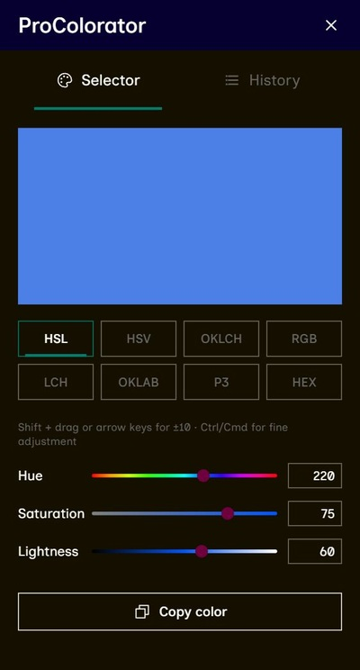

# ProColorator

A desktop color chooser for exploring colors, adjusting their values, and keeping useful shades close at hand.

Built by a designer, for everyday design work. Choose a color, fine-tune it in your preferred color model, and copy its HEX value into your next project.

**[Download ProColorator](https://github.com/bushtwo/ProColorator/releases)** · [Report an issue](https://github.com/bushtwo/ProColorator/issues)

## Preview



## Features

- **Eight color models:** HSL, HSV, RGB, HEX, OKLCH, OKLAB, LCH, and Display P3.
- **Immediate preview:** see the color change as you adjust the controls.
- **Precise adjustments:** use sliders, type numeric values, or drag numeric fields to scrub their values.
- **Copy HEX:** copy the chosen color to your clipboard with one click.
- **Color history:** revisit your last 30 copied colors in a list or grid. History stays on your device between sessions.
- **Proportional resizing:** scale the interface while keeping its original proportions. The desktop app remembers its window size.

This version focuses on choosing and adjusting colors inside the app. Screen sampling and the eyedropper have been removed for now.

## Download

Open the **[Releases page](https://github.com/bushtwo/ProColorator/releases)**, choose a release, and expand **Assets** to find the installer for your system.

| Platform | Installer to look for |
| --- | --- |
| Windows | `.exe` or `.msi` |
| macOS | `.dmg` matching your Mac's architecture |
| Linux | `.deb`, `.rpm`, or `.AppImage`, when available |

The build workflow targets Windows, macOS, and Linux. Installer availability depends on which release builds have completed and been published. The project is still being tested across platforms; please report problems with your OS version and a description of what happened.

## How to use

1. Choose a color model below the preview.
2. Adjust the sliders or numeric fields. Choose **HEX** to enter a HEX value directly.
3. Click the copy button to copy the color's HEX value and add it to history.
4. Open **History** to reuse a saved color or switch between list and grid views.

## Development

ProColorator uses **Tauri 2**, **Svelte 5**, **SvelteKit**, **TypeScript**, and **Rust**.

Install Node.js 22.12 or newer, Rust, and the [Tauri prerequisites for your platform](https://v2.tauri.app/start/prerequisites/), then run:

```sh
npm ci
npm run tauri dev
```

Check the frontend and build a desktop installer:

```sh
npm run check
npm run tauri build
```

Desktop installers are written to `src-tauri/target/release/bundle/`. For a browser-only UI preview, run `npm run dev`.

### GitHub builds

Push to `main`, or run **Tauri Cross-Platform Build** manually from the repository's **Actions** tab. Successful builds attach installers to a **draft release**. Review the builds and publish the release to make its assets visible to visitors through the download link above.

The screenshot is stored in this repository at `docs/images/procolorator.jpg`. Commit it along with this README so the image appears automatically on the repository's GitHub homepage.

See [TESTING.md](TESTING.md) for the focused verification checklist.
